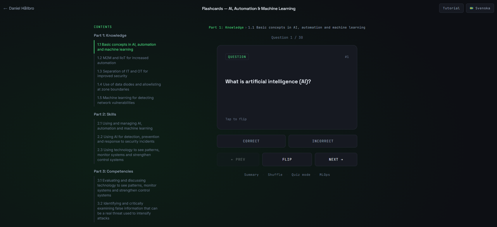

## Overview

The AI, Automation and Machine Learning course at Frans Schartaus Handelsinstitut ends with two interview-style exams. For the first one, our teacher handed out 30 questions to prepare ahead of time. The second one covers the MLOps project. I wanted a way to drill both that worked just as well on the phone as at the desk, so I built one.

## Why I built it

The first goal was simple - get the answers to stick before the exam. Reading through a document of questions and answers only goes so far, and actively trying to recall the answer before flipping the card works a lot better.

The second goal was to share it. Everyone in the class was preparing for the same questions, so instead of keeping it to myself I put it on GitHub Pages and sent the link to my classmates. No accounts, no installs - open the link and start studying, at home or on the bus.

## What I built

The tool has three modes. The flashcards cover the 30 exam questions - flip a card, rate yourself on whether you knew the answer, and get a summary at the end showing which parts and themes need more practice. The quiz turns the same questions into multiple choice with instant feedback on each pick. A separate set of 35 MLOps flashcards works as optional bonus prep for the second exam.

All three share swipe navigation on mobile, a shuffle mode, a guided tour on first visit and a Swedish/English toggle. It is plain static HTML, CSS and JavaScript with no build step - the questions live in their own data files, so adding or changing a question doesn't mean touching the app logic.

## What I learned

The biggest takeaway was taking a tool I had only recently started working with, GitHub Pages, and using it to build something new for learning. It's free, which is what makes it so useful for a project like this - there's no hosting to pay for or set up, and anyone with the link can use the tool straight away.

The other was how much the feedback from my classmates mattered. Once people started using it, suggestions came in on both the content and the interface. I used that feedback to improve the questions and answers and to make the UI easier to understand, and the tool got a lot better for it.

Try it out: [danielhallbro.github.io/ai-flashcards](https://danielhallbro.github.io/ai-flashcards/)
